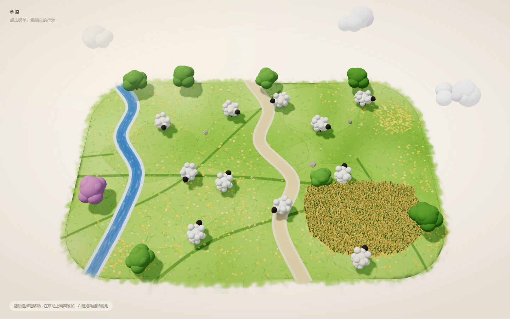

# 草原绵羊编辑器 · Meadow Sheep Editor

> 单文件 three.js 立体草原：可编辑的羊群、随机风场、流动河水、成熟稻田，以及 24 小时昼夜、晴/雨/雪天气与雨雪带来的湿润、积雪和结冰。
>
> A single-file three.js meadow diorama with an editable flock, random wind, flowing water, a ripe rice paddy, a 24-hour day/night cycle and sunny/rainy/snowy weather with wetness, snow cover and a freezing river.

## 在线试玩 / Live demo

**https://onestar1107.github.io/meadow-sheep-editor/**

## 预览 / Preview

## 这是什么 / What it is

一个用 **three.js 0.160** 写的交互式微缩草原场景，全部内容放在一个 **index.html** 里，双击即开。画面是手绘纸艺/软陶质感的圆角草皮岛：11 只黑脸绵羊、一棵紫色树、一条会流动的河、一条土路、一块成熟稻田，以及会随机起风的天空，还有 24 小时昼夜循环、晴天/雨天/雪天切换，以及雨天湿润和雪天积雪、河流结冰。

An interactive miniature meadow built with **three.js 0.160**, shipped as one **index.html** you can open by double-clicking. A hand-painted, paper-diorama style turf island with 11 black-faced sheep, a purple tree, a flowing river, a dirt path, a ripe rice paddy, a randomly gusting sky, a 24-hour day/night cycle, and sunny/rainy/snowy weather with wetness, snow cover and a freezing river.

## 运行 / Run

1. 下载或克隆本仓库，找到 index.html。
2. 双击用浏览器打开（Chrome / Edge / Safari 均可）。
3. 页面需要联网，从 unpkg 载入 three.js 0.160 与 OrbitControls；没有构建步骤、没有 npm 安装。

1. Download or clone this repository and locate index.html.
2. Double-click it in a browser (Chrome / Edge / Safari).
3. It needs internet access to load three.js 0.160 and OrbitControls from unpkg. No build step, no npm install.

## 操作 / Controls

| 操作 | 效果 |
| --- | --- |
| 左键点击绵羊 | 选中：出现 8 个控制点、尺寸标签和行为工具栏；这只羊默认开始行走 |
| 拖动蓝色选择框 | 平移绵羊（相机不转） |
| 在草地上按住左键画圈 | 松开后在该区域生成一只新绵羊，不会和已有羊重叠；新羊默认直接行走 |
| 空白处左键拖 / 右键拖 | 旋转视角 |
| 滚轮 | 缩放 |
| 工具栏 | 待机 / 吃草 / 行走 / 跳跃 · 撤销 / 重做 / 复制 / 删除 |
| Ctrl/Cmd + Z | 撤销；加 Shift 为重做 |
| 右上角时间滑杆 | 拖动切换 0–24 点；时间自动前进，约 8 分钟走完一天 |
| 右上角 晴 / 雨 / 雪 | 切换晴天、雨天和雪天：光照、天空、云层、雨丝/雪花、湿润与积雪同步过渡 |
| 打开 / 刷新页面 | 天气随机（晴 / 雨 / 雪）；11 只羊默认直接行走，不再从待机开始 |
| 雪地 / 湿地行走 | 羊走过会留下蹄印：雪地是蓝灰压痕，湿地是深色湿印，几秒后淡出；切晴后消失更快 |

## 场景里有什么 / What's inside

- **草皮岛**：44 × 29 m 圆角矩形，Canvas 程序化 alpha 毛边遮罩，奶油色边缘 + 深绿色薄侧壁，像一块浮起来的草皮。
- **羊群**：11 只，奶油色毛球、黑脸、短腿；层级为 root → bob → body / neck / legs[4] / tail；整体缩放 1.25。
- **行为**：待机、吃草、行走、跳跃。跳跃总时长约 0.82 秒，世界高度顶点约 0.62 m；只有身体做 squash/stretch，腿在腾空时收起。
- **河流**：自定义 ShaderMaterial，两层噪声沿河道向下游滚动，带淡蓝 glint、岸边泡沫和低强度太阳反光；用岛屿遮罩裁掉河岸外的部分。风会让水面起伏、亮纹和泡沫略有变化，但保持连续顺滑。
- **稻田**：低矮田埂 + 约 3200 株实例化稻丛；每株 8 片绿叶 + 3 个交叉 ribbon 稻穗，稻穗向上拱起再下垂；顶点色分层（叶绿、穗琥珀金），随风摆动。羊的漫游目标会避开稻田。
- **树与云**：8 棵树（其中一棵紫色）、3 块石头、3 朵云；树冠和树干在风中的响应不同。
- **光照**：暖色平行光 + 半球光 + ACES 色调映射 + VSM 软阴影 + 页面暖色暗角；太阳随 24 小时沿东→西弧线移动。
- **时间与天气**：24 小时循环；日出/日落暖色、夜间冷色月光与深蓝天空。天亮时天空有太阳，入夜换成月亮；太阳/月亮是 3D 场景里的天体，位于岛上方天空（页面顶部的目标区域），随场景旋转缩放；不画在页面背景或 DOM 上。雨天太阳/月亮完全收起（云层遮住），雪天变淡。右上角半透明面板可拖时间、切晴/雨/雪；面板底色实时取自当前天空色，文字明暗随之切换。每次打开或刷新页面，天气在晴/雨/雪中随机。
- **雨天**：太阳/月亮收起、约 2200 条随风倾斜的雨丝、深灰云层、压暗光照和一层雨雾；地面、树、羊和稻田变暗变湿，草地/路面带一点湿光。
- **雪天**：雪花飘落，雪层逐渐加厚，树顶积雪，稻田积雪、路面转白；河流随积雪慢慢结冰，雪停后冰面缓慢融化。河岸、道路边缘做了羽化，随天气过渡更自然。
- **稻田积雪**：雪层会积在田面和稻穗上，稻穗加白色雪帽，稻叶/稻杆仍透出来，不会变成一整块没有细节的白板。
- **蹄印**：羊在雪地或湿地面行走时会留下蹄印；雪地是蓝灰压痕，湿地是深色湿印。每枚约 6–8 秒淡出，切回晴天时约 1–2 秒快速消失，羊多时也不会铺满一地。
- **界面**：全部简体中文；选中标签显示“宽 × 高 米 · 距离 米”。

## 风、水、稻田 / Wind, water, rice

风是一个全局风场：基础强度每 2–6 秒随机换一次（约 0.05–1.2），方向缓慢摆动，再叠加阵风噪声。轻的物体（树冠、稻叶、稻穗）始终随风动；重的物体（树干）只在风力超过 0.5 时轻微倾斜（最大约 3.4°），小风时保持完全静止。稻子用顶点着色器摆动，叶片和稻穗顺风弯，并有从田这头传到那头的行波；河面用风 uniform 调整起伏、流速与亮纹强度，但不会把水纹撕成白色碎线。

## 脚印与默认行为 / Hoofprints & default walk

- 打开/刷新页面时天气随机，11 只羊全部默认行走；点选任意一只羊，它会立刻开始行走；圈选生成的新羊也默认行走。
- 羊在雪地（积雪达到一定程度）或雨天湿地（地面足够湿）行走时，会按约 0.8m 的步距留下左右交替的蹄印；雪地偏蓝灰、湿地偏深色，约 6–8 秒淡出，切晴后约 1–2 秒快速消失。
- 蹄印使用贴地小平面 + 程序化蹄形纹理，按 terrainH 高度放置，不会穿进地面。

## 时间与天气 / Time & weather

**时间**从 08:00 开始，约 8 分钟走完一天（可在右上角滑杆拖到任意时刻）。太阳位置、光色、强度、天空底色、云色和曝光都由同一套时间关键帧插值：清晨偏桃色、白天奶油色、黄昏橘粉、夜晚深蓝并用冷色月光；页面文字在夜间自动切浅色。

**天气**分晴、雨、雪三种，约 2 秒平滑过渡。

- **雨天**：太阳/月亮收起、天空灰蓝、云层转深灰，约 2200 条雨丝随风斜落并叠一层雨雾；雨水让草地、树、羊、稻田和路面变暗、变湿，草地和路面的粗糙度降低，带一点湿光。
- **雪天**：雪花飘落；岛上覆盖一层逐渐加厚的雪，树冠顶部积雪，稻田积雪、路面转白；河流的冻结程度慢慢升高，水面变成带冰纹的淡蓝白，雪停后缓慢融化。河岸和道路边缘做了 alpha 羽化，湿/雪/晴之间过渡更自然，不再是一条硬边。

右上角控制面板是半透明的：底色直接取当前天空色（约 40% 不透明度）并做背景模糊，文字在深色天空下自动转浅，因此昼夜和晴/雨/雪变化时面板会跟着背景一起变。

## 代码结构 / How it works

全部逻辑在 index.html 内，按 0–13 分节：

- 0 · helpers：数学工具、全局风场
- 1 · island metrics：岛屿尺寸、圆角矩形轮廓
- 2 · renderer / scene / camera：渲染器、轨道相机、ACES
- 3 · lighting：平行光、半球光、VSM 软阴影
- 4 · textures：草地、田土、岛屿毛边遮罩等 Canvas 纹理
- 5 · island mesh：圆角草皮网格与侧壁
- 6 · rivers / road / wheat：河流、道路、水面 shader、田埂与实例化稻丛
- 7 · trees / rocks / clouds：树、石头、云
- 8 · sheep：程序化羊模型、层级、材质
- 9 · behaviour：待机 / 吃草 / 行走 / 跳跃状态机
- 10 · selection UI + history：8 个控制点、尺寸标签、工具栏、撤销/重做/复制/删除
- 11 · picking：拾取、拖动、圈选生成、轨道控制切换
- 12 · time of day / weather：24 小时关键帧、太阳/月亮、天空/云/水色、雨丝与雨雾、雪层/雪花/结冰、湿润、随机天气、河岸/道路羽化与自适应 HUD
- 13 · loop：风场、昼夜与天气更新、树/稻/水 uniform、渲染循环

关键实现：Canvas 程序化纹理；岛屿 mask 通过 onBeforeCompile 注入到草地/河流/道路 shader；稻丛用 InstancedMesh + onBeforeCompile 风摆；屏幕空间 AABB 做选择框；射线与地面求交做拖动和圈选；圈选用 shoelace 面积 + 点在多边形内判断。

## 文件 / Files

- index.html — 全部场景、样式与逻辑（约 104 KB）
- docs/PROMPT.zh.md — 中文 AI 复刻提示词
- docs/PROMPT.en.md — English AI prompt
- .gitignore — 忽略本地记忆库与测试产物

## AI 提示词 / AI prompts

- 中文：[docs/PROMPT.zh.md](docs/PROMPT.zh.md)
- English: [docs/PROMPT.en.md](docs/PROMPT.en.md)

这两份提示词是根据最终成品整理的“完整复刻提示词”，可以直接粘给 AI，让它从零生成同款单文件场景。中英内容一一对应。

## 已知限制 / Limits

- 需要联网从 unpkg 载入 three.js；离线打开会显示中文兜底提示。
- 需要支持 WebGL2 的浏览器；移动端可打开，但手势与性能未专门优化。
- 单文件约 104 KB，所有纹理都是运行时 Canvas 生成，没有外部图片/模型资源。
- 羊的尺寸标签是世界空间 AABB，会随羊的朝向略有变化。
- 未附加开源许可证；如需 MIT 等许可证，请仓库作者补充 LICENSE。

## 许可 / License

No license file is included yet. Add one (for example MIT) if you want others to reuse this project.
